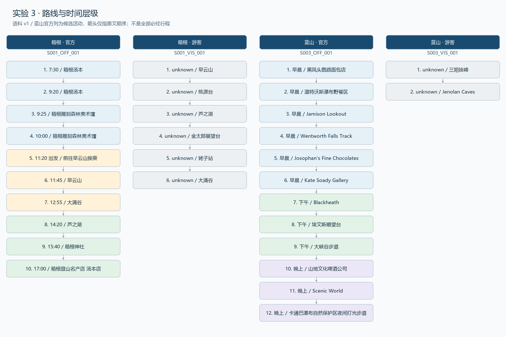
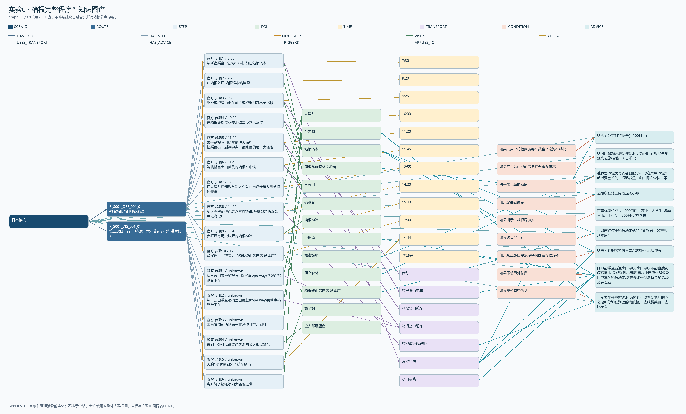

> 历史章节记录：当前v3修订、数量和验收状态以exp03_routes.md、exp06_graph.md及修复记录_20261111.md为准。旧引用与数量保留历史，不当作当前结果。

# 数据挖掘探索性实验报告

YZH 章节稿。按课程模板的节次编排，可复制到小组报告的实验 3、实验 6 及对应总结位置。复核基线为 `yzh/routes-graph` 提交 `f345e09`。

## 实验项目 3 游览路线的层级结构挖掘

### 3.1 路线描述模式与输入范围

从项目 1 清洗后的 v1 语料选择日本箱根和澳大利亚蓝山，每个景区使用一篇官方推荐路线和一篇游客游记。箱根官方路线以钟点分隔步骤，如 S001_OFF_001 的“7:30 ~ 从新宿乘坐‘浪漫’特快前往箱根汤本”。蓝山官方路线按早晨、下午和晚上分段，段内的推荐地点散落在正文中。游客游记以“从”“到”“来到”等行进表述组织步骤，可能混有远眺、否定或可选活动，不能将所有地点提及都计为到访。其余 14 篇语料未纳入本实验的路线输出。

### 3.2 统一结构化表示与解析程序

`src/exp03_routes.py` 将四篇文本写为 `data/outputs/routes.json`，每条路线保存景区、文档、来源类型和有序步骤。步骤包含整数序号、原文时间、时间段、地点原词与标准实体 ID、活动、停留时长和证据。钟点标题优先抽取“前往”后的目的地。蓝山段落继承时间标题，结合地点词表、推荐语和图片说明过滤提取步骤。游记采用子句切分、地点最长匹配和行进词检测，保留起始“从 A 到 B”的两端，过滤否定、备选与纯眺望片段。

原文证据采用清洗正文的 Python 字符区间 `[start,end)`。原文未给出明确钟点或停留时长时，对应字段保存 `null`，未确定的时间段保存 `unknown`。

### 3.3 时间层级构建

明确钟点按 11 点前、11–12 点、13–17 点、18 点起分为上午、中午、下午和晚上。蓝山路线保留段落提供的时间层级，不将“早晨”换算为具体钟点。步骤按原文顺序排列，时间分组不会改动原有顺序。

图 3-1　箱根与蓝山四条路线的时间层级

### 3.4 名称归一化与稳健性

使用 DHT 正式目录 exp02-v1.1，限定同景区、活跃 POI，按标准名或别名唯一匹配。中英文复合名称只在两部分各自指向同一个 ID 时合并。“姥子缆车站”对齐至姥子站 `S001_POI_026`。温特沃斯瀑布野餐区使用独立 ID `S003_POI_052`，保留与瀑布、步道及镇区的边界。相同地点对应不同活动时保留各自步骤。

### 3.5 结构结果验证

输出 4 条路线和 30 个步骤，全部对齐正式实体。31 段证据通过原文位置检查。例如 S001_OFF_001 的 `[222,246)` 对应箱根官方第 1 步，活动为乘“浪漫”特快前往箱根汤本，钟点为 7:30，归入上午。开发集的步骤匹配从 29/30 提升至 30/30。参考顺序参与了规则开发，独立语义复核待组员完成。

首版把“从大涌谷前往芦之湖”取为大涌谷，改为优先识别目的地后更正。短句过滤曾漏掉蓝山晚间的山地文化啤酒公司，加入推荐语判断后恢复该步。后续仍需用新文档检查复杂目的地与图片说明。

### 3.6 官方与游客实际路线对比

表 3-1　两地官方路线与游客游记的结构对比

| 维度 | 箱根官方 / 游客 | 蓝山官方 / 游客 |
| --- | --- | --- |
| 步骤数 | 10 / 6 | 12 / 2 |
| 地点集合 Jaccard | 3 / 10 = 0.30 | 0 / 14 = 0 |
| 地点序列最长公共子序列长度 | 2 | 0 |
| 有明确时间层级的步骤 | 10/10 / 0/6 | 12/12 / 0/2 |

Jaccard 使用标准地点集合的交集除以并集，最长公共子序列保留地点的先后关系。箱根两条路线共有早云山、大涌谷和芦之湖，后两处访问顺序相反。蓝山游客的三姐妹峰和珍罗兰洞与所选官方实际到访地点无交集。官方文本中的远眺对象不计为到访，珍罗兰洞作为游客实际行程中的周边地点保留。两篇游记缺少足以比较每站停留时长的数据。

## 实验项目 6 多源程序性知识融合与图谱可视化

### 6.1 输入来源与融合流程

图谱 v2 读取景区登记表、DHT 的 `entities.json`、YZH 的 `routes.json` 和 FYH 的 `advice.json`。YZH 完成路线抽取、实体对齐及基础图谱，FYH 接管后完成 20 条条件建议的融合、查询工具和完整布局，YZH 复建并验收结果。实体以正式 ID 关联，路线、步骤和建议保留各自标识。来自不同文档的步骤和建议保留来源及证据，实体可共享，各条路线的顺序链保持独立。

### 6.2 对齐样例与噪声诊断

“早云山”和“早云山站”依据已确认别名共享 `S001_POI_009`。野餐区、瀑布、步道和镇区分别建模。过滤停用实体及未被路线或建议关联的目录项。DHT 将“姥子缆车站”标为完整 POI 后，原先由站名内部“缆车”产生的交通边随复建移除。实体是否保留取决于有效引用及证据，频次高低仅用于描述。

### 6.3 图谱模式设计

节点类型为景区、路线、步骤、地点、时间、交通、条件与建议。节点保存 ID、类型、名称、景区、来源文档及属性，提取型节点和关系保留原文证据。

表 6-1　图谱关系方向及记录数

| 关系 | 方向 | 数量 |
| --- | --- | ---: |
| HAS_ROUTE | 景区 → 路线 | 4 |
| HAS_STEP | 路线 → 步骤 | 30 |
| NEXT_STEP | 同一路线前一步 → 后一步 | 26 |
| VISITS | 步骤 → 地点 | 30 |
| AT_TIME | 步骤 → 时间 | 14 |
| USES_TRANSPORT | 步骤 → 交通 | 14 |
| HAS_ADVICE | 景区 → 建议 | 20 |
| TRIGGERS | 条件 → 建议 | 20 |
| APPLIES_TO | 建议 → 涉及的地点、交通或时间 | 47 |

### 6.4 构建实现与结构化输出

`src/exp06_graph.py --require-complete` 生成 JSON 和节点、边 CSV。`src/exp06_verify.py` 加载为 NetworkX MultiDiGraph。全图 151 节点、205 边，节点包括 3 个景区、4 条路线、30 个步骤、47 个地点、15 个时间、12 个交通、20 个条件和 20 个建议。4 条步骤链长度为 10、6、12、2，三个弱连通分量对应三个景区。

### 6.5 图谱可视化

箱根展示 69 个节点和 103 条边，按关系组织路线、步骤、实体及条件建议。PNG 用于报告，HTML 支持检索节点 ID、边和来源。

图 6-1　箱根完整游览知识图谱

### 6.6 质量验证与结果分析

表 6-2　可回查的图谱查询结果

| 输入 | 实际结果 | 核查依据 |
| --- | --- | --- |
| S001，上午路线 | 官方路线前 4 步 | 原步骤编号及各步时间证据 |
| S001，family 建议 | 返回 1 条，涉及泡泡城堡和网之森林 | S001_OFF_001 `[1084,1134)`，条件为“对于带儿童的家庭” |
| S003，weather 建议 | 返回 1 条雨天活动回答块 | 结果保留完整条件、建议及文档证据 |
| S001，elderly 建议 | no_match | 正式建议未标注 elderly，查询按记录标签过滤 |

通过节点和边端点、来源区间、同景区实体、建议覆盖与步骤链检查，无孤立节点。大涌谷有 3 条 VISITS，分别对应官方不同活动及游客路线。APPLIES_TO 当前只表达关联，缺少原交通和替代交通的角色区分。跨句交通提及、完整行程时长和实时开放状态也存在数据缺口。全链路离线验收及 43 项测试通过。组员独立语义复核仍待完成。

## 提交附件与复现

- 路线结果与指标见 [routes.json](../data/outputs/routes.json)、[exp03_metrics.json](../results/checks/exp03_metrics.json) 和 [路线对比](../results/checks/exp03_comparison.md)。
- 图谱结果与查询见 [graph.json](../data/outputs/graph.json)、[exp06_quality.json](../results/checks/exp06_quality.json) 和 [交互图](../results/figures/exp06_hakone_graph.html)。
- 运行命令、依赖和验收范围见 [运行与验收](YZH_运行与验收.md) 与 [全链路验收](../results/checks/exp05_07_acceptance.json)。
- 总结段落可引用 [YZH 反思与研究计划](YZH_反思与研究计划.md) 中的真实失败、局限和一个研究方向。
