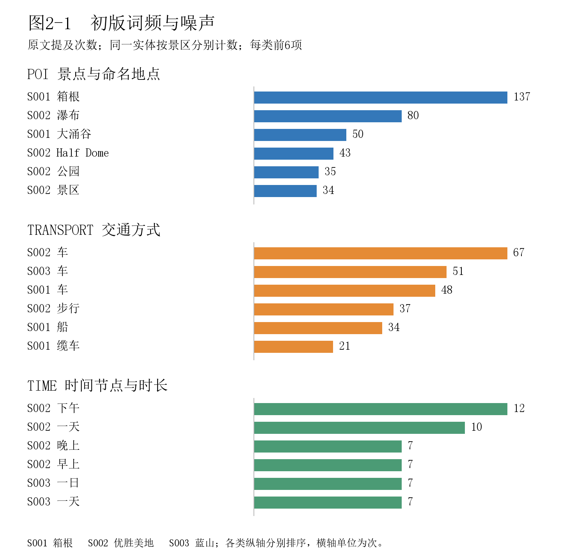
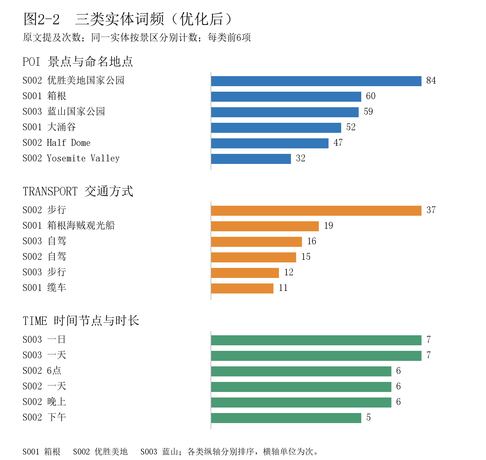
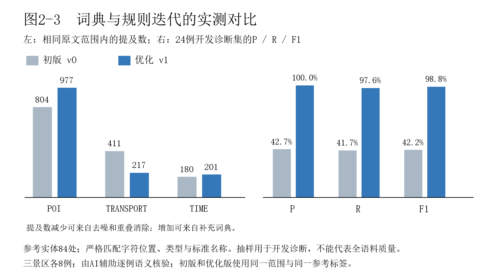

# 实验2 游览步骤的实体识别

负责人：DHT。状态：实现与成果已交付 main；参考样本由AI辅助复核，仍非独立人工测试。

## 2.1 输入数据与实体定义规范

本实验以实验1的corpus.jsonl为输入，识别POI、TRANSPORT、TIME三类实体，为路线解析与图谱融合提供统一目录及原文证据。沿用schema_version=1.0、corpus_version=v1，覆盖箱根、优胜美地国家公园、蓝山国家公园各1份官方路线和5篇游客游记，共18篇。完整正文154930字符；按已登记的游览与接驳范围抽取42911字符，排除长篇游记的其他城市章节、网页推荐及视频内容，原文不做二次清洗。

表2-1 三类实体定义规范（各景区采用相同判定标准）

| 类型 | 定义与边界 | 排除或歧义 | 示例 |
| --- | --- | --- | --- |
| POI | 有名称的景点、步道、站港、服务设施和必要接驳地点；完整专名优先。 | 不纳入无名泛称；父子区域分开，园外地点标明scope。 | 箱根神社；El Capitan；Leura |
| TRANSPORT | 明确的交通方式、线路或服务名，包括步行、自驾、巴士等。 | 票券不是方式；缆车制式不明时保留泛称，站名中的交通字不重复标。 | 箱根登山缆车／空中缆车；shuttle |
| TIME | 原文的时刻、时段、日序、月日或行程时长；保留明确范围。 | 排除下午茶、程度词一点、历史寿命及视频时长；不推算缺失时间。 | 7:30；第二天；5-7 hours |

名称归一化以来源语义和明确别名为依据：Half Dome与“半穹”共用目录ID；Half Dome Trail单独保留；Yosemite Falls及其上瀑、下瀑不合并。箱根登山缆车与箱根空中缆车分别登记，泛称“缆车”仍保留为泛称。同名的新娘面纱瀑布在优胜美地与蓝山使用不同ID，避免跨景区错误合并。

POI的scope标记inside、surrounding、external或regional，分别表示游览区内、周边接驳、园外及父级区域。例如新宿为箱根的园外接驳点，Leura为蓝山周边镇区。Wentworth Falls英文裸名存在镇区／瀑布歧义，目录保留说明；箱根汤本与车站暂共用入口节点，尚未细拆。完整规范见reports/exp02_entity_definitions.md；这些分区不等同于法定地理边界。

## 2.2 识别方法与批量实现

采用离线领域词典与正则规则，无需调用在线模型。流程为：读取并校验v1语料及范围清单→按景区匹配POI与交通词→匹配时间候选→按最长优先消除重叠→建立实体目录和逐次提及→验证原文位置→统计与绘图。资源为data/resources/exp02_lexicon.json及exp02_scope.json，含169条POI登记、19条交通规则、7组时间规则。并非每条词典记录都必须在当前范围内出现。

英文别名匹配忽略大小写并检查字母边界，词间空白可变，但始终在原文字符串上定位。优化版按候选字符长度降序选择，重叠时保留完整专名，例如识别“箱根登山电车”后不再重复产生其中的“箱根”“电车”。相同名称在同一句出现两次则保留两条提及。所有新实体ID递增登记，复跑读取旧结果维持既有ID；停用实体保留active=false，便于下游追踪。

时间规则覆盖7:30、下午3点、第二天、7月18日、5-7 hours、30min等表达，区分时刻、时段、行程日序、月日与时长。采用保守表面归一化，如30min→30分钟、2 days→2天；不把时长推算为到达时刻，也不把历史年份、延寿传说和视频时长当作游览时间。“下午茶”与表示程度的“一点”按上下文排除；Half Dome Pizza与Sydney HeliTours等商品／运营商名称不当作地点。

实现入口为src/exp02_entities.py，检查入口为src/exp02_verify.py，绘图入口为src/exp02_visualize.py。实测Python 3.12.14、Pillow 12.3.0；识别与检查仅用标准库，Python 3.11+为兼容目标，未宣称已在3.11实测。离线处理不涉及网络重试；输入文件、版本、范围标记或字段不符时明确报错并退出，避免生成错位结果。复现命令在2.5末列出。

## 2.3 实体输出与出现位置

正式结果保存为data/outputs/entities.json，顶层含版本、语料SHA-256、entity_catalog和mentions。目录共327条，其中326条活跃、1条停用；本次输出1403次提及：POI 981、TRANSPORT 221、TIME 201。实体目录保留entity_id、scenic_id、entity_type、canonical_name、aliases；提及保留mention_id、entity_id、类型、span与method。

表2-2 分景区结果统计（字符为实际抽取范围；实体数只计活跃目录项）

| 景区 | 抽取字符 | POI | 交通 | 时间 | 活跃实体 |
| --- | --- | --- | --- | --- | --- |
| S001 箱根 | 10082 | 295 | 95 | 41 | 92 |
| S002 优胜美地 | 24494 | 424 | 64 | 107 | 148 |
| S003 蓝山 | 8335 | 262 | 62 | 53 | 86 |
| 合计 | 42911 | 981 | 221 | 201 | 326 |

出现位置统一为完整v1正文中从0开始的Python字符区间[start,end)，end不包含在内，不按字节、不按分词结果计数。实际输出样例如下：
{"mention_id":"M_S001_OFF_001_0011","entity_id":"S001_TIME_003","entity_type":"TIME","span":{"doc_id":"S001_OFF_001","start":222,"end":226,"text":"7:30"},"method":"rule"}

运行src/exp02_verify.py后，1403/1403条提及均满足corpus_text[start:end]==span.text，实体引用及所属景区一致，ID无重复，同篇提及无重叠，11个停用泛词无独立残留。完整复跑结果相同，倒置文档处理顺序后既有实体ID和提及ID仍保持不变。质量记录见results/checks/exp02_quality.json。以上属于结构检查，不能替代语义效果评价；公共语料哈希也已核对，未改变实验1正文。

## 2.4 人工抽查与错误分析

按目的抽样从三景区各选8例，共24例、84处参考实体，覆盖官方及游客文本，包含同句重复、交通制式、上下位地点、错拼、否定语境及无实体负例。逐例阅读原文后编写参考标签，再核对初版和优化预测；严格以字符起止位置、类型、标准名称四项完全一致为正确。本次由AI辅助完成语义核验，不冒称学生或组员已独立复核。完整24例原句、位置、两版预测及判定见results/checks/exp02_review.md。

表2-3 代表性原文核验与错误分析（完整句子及偏移见对应案例记录）

| 案例 | 来源及原文区间 | 实际输出与核验判断 |
| --- | --- | --- |
| C02 | S001_OFF_001 [1342,1389) | “箱根登山电车强罗站…箱根登山缆车”：初版产生箱根、电车等嵌套项；优化后完整识别两种交通及强罗站，末尾泛称缆车独立保留。 |
| C06 | S001_VIS_003 [448,501) | “…酒店下午3点…桃源台乘海贼船游览芦之湖”：优化后下午3点边界完整，同句两次桃源台位置不同，海贼船对齐标准交通。 |
| C08 | S001_VIS_003 [285,368) | “…原来是硫磺谷…”：两版均未识别该地点；核验应有描述性POI，但不能未经确认就合并大涌谷，列为待确认漏项。 |
| C10 | S002_OFF_001 [788,835) | “Lower Yosemite Fall (shuttle stop #6)”：优化后下瀑与shuttle正确；#6不标为时间，下瀑不合并父级瀑布。 |
| C13 | S002_VIS_001 [3482,3587) | “…标志性的Half Doom…”：词典不含该错拼，优化版仍漏识别；上下文疑似Half Dome，需确认后补别名。 |
| C18 | S003_OFF_001 [3787,3806) | “巴士每天上午9点至下午5点每小时一班”：两端时刻识别完整；仍漏“每小时”，应补发车频率规则。 |
| C22 | S003_VIS_004 [2790,2855) | “Sydney HeliTours…悉尼 - 蓝山…45分钟”：优化后排除运营商中的Sydney，保留真实悉尼、蓝山及45分钟。 |
| C23 | S003_VIS_004 [6354,6418) | “…更有趣一点…”：优化后无实体；“一点”是程度，不是时刻，初步检查发现的错误已排除。 |
| C24 | S003_OFF_001 [5105,5112) | “水疗盛宴下午茶”：优化后无实体；下午茶是餐饮表达，不能切分为下午节点。 |

同一24例诊断集上，初版TP=35、FP=47、FN=49；优化版TP=79、FP=0、FN=5。按P=TP/(TP+FP)、R=TP/(TP+FN)、F1=2PR/(P+R)计算，初版P=42.68%、R=41.67%、F1=42.17%；优化版P=100.00%、R=94.05%、F1=96.93%。抽样用于开发诊断且参与规则修正，含有意选取的易错例，不能据此宣称全语料准确率100%或独立泛化能力。

仍有5处漏识别：C08“硫磺谷”、C13“Half Doom”、C15“Glacie Point”、C16“horsetail”、C18“每小时”。前两类问题来自描述性称呼与错拼／简称不在已确认词典，后者来自频率时间表达缺少规则。优先将候选原词、上下文和建议标准名交由实体维护者确认，再增量登记；补充“每小时一班”等规则后另设未参与修改的新样本复评。待确认名称及证据已保存exp02_pending_aliases.json，当前不通过猜测强行合并。

## 2.5 三类实体词频可视化与迭代

按每次原文提及计数，同一实体多次出现分别累计，别名在同一景区合并到标准ID，跨景区不合并；图2-1、图2-2分别展示各类前6项。初版与优化版采用相同42911字符范围：三类提及数由822／418／180变为981／221／201。初版中“瀑布”“车”等泛称及嵌套短词造成噪声，优化时移除7个POI泛词、4个交通泛词，补充领域词典与英文／中文时间边界，并应用最长匹配和上下文排除。

图2-1 初版词频：泛称噪声与嵌套子词的影响

图2-2 优化后三类实体词频：按景区及标准实体ID计数

图2-3 优化前后提及数与24例诊断指标对比

图2-2中优胜美地父区域、箱根、蓝山父区域出现较多，反映文档描述对象；优胜美地步行提及37次，箱根海贼观光船20次，符合语料中的步道与多交通接驳叙述。该结果是文本频次，不能推导景点受欢迎程度、真实客流或当前可达性。各类横轴独立缩放，具体数值以条末标签为准。

三个景区的抽取正文长度不同，因此另输出exp02_scenic_density.csv，以每10000字符提及数辅助跨景区比较；主图保留原始频次。当前TIME尚未完整合并“一日／一天”“一个小时／一小时”等等价写法，未知别名与跨句省略也会漏抽；泛称缆车仍不强行推定制式。后续可采用受约束的模型候选发现，再用独立分层样本对照词典基线，评价精确率、召回率与边界错误。

从项目根目录依次运行：
python src/exp02_entities.py --variant baseline
python src/exp02_entities.py
python src/exp02_verify.py
python src/exp02_visualize.py

实验2代码、结构化结果、三张彩色图、实体规范、24例逐项核验及交接说明已保存在本地。交接对象为YZH、FYH，读取方式见results/checks/exp02_handoff.md；组员接收状态尚未确认。本次仅填写模板的实验2章节，其他实验与封面信息保留模板状态，未上传或推送GitHub。

完整实体定义表见[规范](exp02_entity_definitions.md)，完整24例核验见[核验记录](../results/checks/exp02_review.md)。