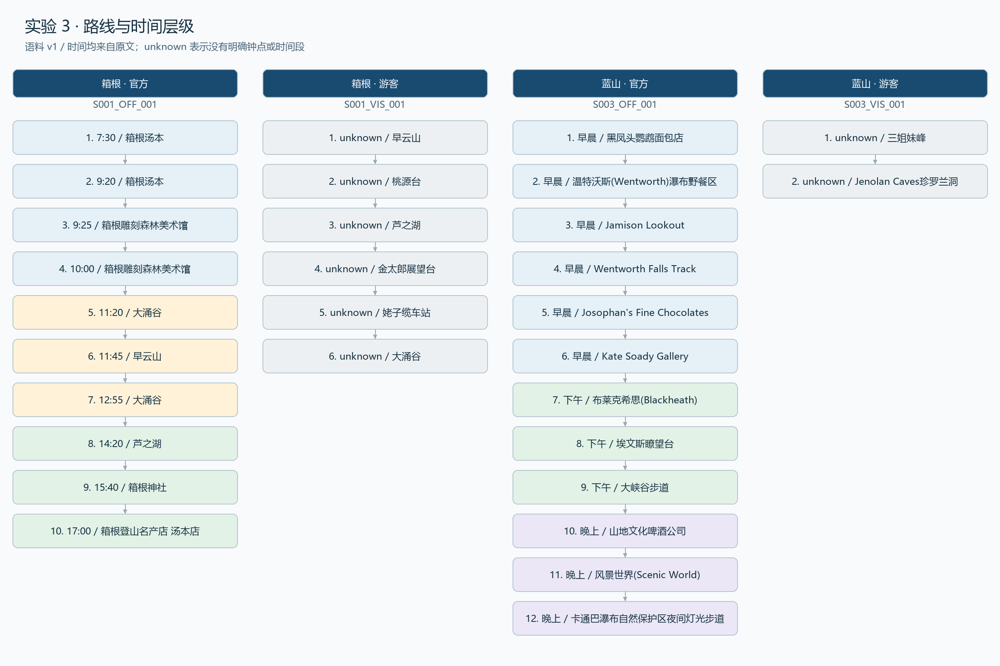

# 实验 3：游览路线的层级结构挖掘

负责人：YZH。数据版本：schema_version=1.0、corpus_version=v1。已接入 DHT 的正式 entities.json（exp02-v1），30 步中 25 步唯一对齐、5 步保留待确认；参考标注等待组员复核。

## 1. 输入与模式分析

读取 DHT 交付的 corpus.jsonl，选取箱根和蓝山的官方文本、各一篇游客游记，共 4 篇。其余 14 篇不纳入本次评估，不宣称全语料覆盖。

| 文档 | 格式与处理范围 |
| --- | --- |
| S001_OFF_001 | 行首 HH:MM ~ 活动标题；解析当日 10 个时间标题 |
| S001_VIS_001 | 行进叙述；抽取具名的出发、到达及途经位置 |
| S003_OFF_001 | 同一文档含多个来源与方案；只截取“早晨:咖啡”至“到达那里”之前的一日游段落，按早晨/下午/晚上继承时间层级 |
| S003_VIS_001 | 行进叙述；排除“没有去”等否定描述，保留真实行进片段 |

箭头链、编号列表是可能的其他格式，本次所选文本的稳定模式是钟点标题、时间段标题和行进叙述，规则不假定未验证格式。

## 2. 核心实现与字段

入口 src/exp03_routes.py；词表和通用子句规则在 src/exp03_rules.py。词表来自本次语料，用于检测地点字面串，不创建标准实体 ID。游客路线已移除首版整句固定锚点，改为句子/子句切分、地点最长匹配和行进词检测；起始“从 A 到 B”保留两端，一般行进子句取最后地点，避免把“眺望芦之湖的金太郎展望台”拆成两个到达点。否定、计划和可选岔路、纯眺望以及“只有缆车直通”等交通常识描述被过滤。该启发式仍依赖词表，不能保证任意新游记的效果。

官方钟点标题优先取“前往”后的目的地。没有地点的交通标题从紧接正文取地点，并补充地点原文证据。蓝山段落使用标题继承，不把“早晨”估算成某个钟点。11 点前归 morning、11–12 点归 noon、13–17 点归 afternoon，其后归 evening；这是明确写出的分桶规则，不推断实际到达时间。

输出 data/outputs/routes.json。每条路线有 route_id/scenic_id/doc_id/text_type/route_name/steps；每步包含 step_no/time_bucket/time_text/poi_entity_id/poi_name/activity/duration_minutes/evidence。证据按 Python 字符区间 [start,end) 定位清洗正文。没有可靠停留时长时保留 null，不能以交通耗时替代停留。scope_note 保留来源范围，游客走到景区周边的珍罗兰洞不因此被认定为公园内部景点。

## 3. 结果与评估

实际输出 4 条路线、30 步：箱根官方 10、箱根游客 6、蓝山官方 12、蓝山游客 2。31 段原文证据全部通过位置与地点支撑检查。图表见下方。

参考顺序存 results/checks/exp03_gold.json，由本次开发逐条对照原文整理，待组员复核。这是规则开发集，不是独立测试集，也不等于已有第二人完成标注。src/exp03_evaluate.py 用 raw_poi_name 对照参考顺序评价抽取，用标准 poi_name 比较官方/游客路线，防止名称归一化被误计为抽取错误。完整分子分母保存在 exp03_metrics.json。

| 路线 | 输出步数 | 参考步数 | 正确匹配 | 召回率 | LCS/参考长度 |
| --- | ---: | ---: | ---: | ---: | ---: |
| 箱根官方 | 10 | 10 | 10 | 100% | 10/10 |
| 箱根游客 | 6 | 6 | 6 | 100% | 6/6 |
| 蓝山官方 | 12 | 12 | 12 | 100% | 12/12 |
| 蓝山游客 | 2 | 2 | 2 | 100% | 2/2 |

修复前精确率 29/29、召回率 29/30=96.67%（见 exp03_metrics_before.json）；修复后精确率 30/30、召回率 30/30（见 exp03_metrics.json）。小规模开发集、词表覆盖和边界定义会使这些数字偏乐观，不能据此声称其他 14 篇或新景区同样准确。官方/游客的地点重合、顺序和时间表达对比见 results/checks/exp03_comparison.md。

## 4. 名称对齐、噪声与失败分析

仅在 DHT 活跃实体目录中“同景区 + POI 类型 + 正式名或别名精确匹配”唯一命中时，填写 poi_entity_id 并采用 canonical_name；多义别名保持待确认，不按名字相似度强行合并。父区域与子景点不自动合并。DHT 已确认“早云山/早云山站”和“箱根汤本/箱根汤本站”的当前目录映射，本次据此对齐，同时保留其关于站区粒度的 note。raw_poi_name 保留原词。5 个未匹配地点及证据见 results/checks/exp06_alignment.json。

真实失败 1：首版把“从大涌谷前往芦之湖”匹配为大涌谷，原因是按词表首个命中取名。改为优先目的地后，第 8 步输出芦之湖；多目的地或复合行程仍需额外句法判断。

真实失败 2：蓝山官方晚间段落中的“山地文化啤酒公司”曾漏抽。词表中已有该地点，但规则将短描述当作图片说明过滤，导致步骤召回少 1。修复时对含“推荐/被公认为/不容错过”等推荐语义的短句予以保留，地点已进入第 10 步；修复前后的指标均保留。该规则是在开发集上调整，仍需在独立段落集验证，以避免增加图片标题误抽。

官方的“前往大涌谷”与“在大涌谷游览”属于不同活动步骤，不因地点相同删除；只删除叙述中连续同名地点造成的重复到达记录。此策略也可能漏掉同地点重复活动，属于方法局限。

## 5. 复现与交接

算法与评估只使用 Python 标准库，Python 3.11+。图表另需 Pillow；依赖与完整顺序见 reports/YZH_运行与验收.md。运行：

    python src/exp03_routes.py
    python src/exp03_evaluate.py
    python src/yzh_figures.py

结构化结果、开发集、指标、PNG 和原文证据可以对应核查。交接说明见 results/checks/exp03_handoff.md。
