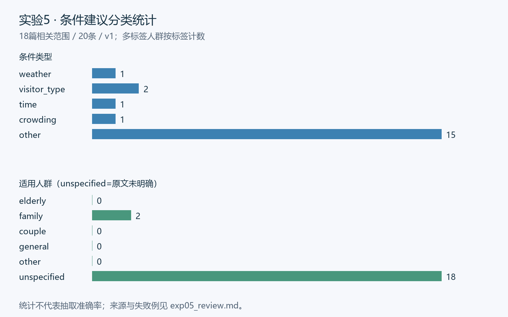

# 实验5：条件性游览建议抽取

## 本轮最终状态

当前exp05-v1.2正式21条建议，条件建议边界与上轮相同。entity_roles为每个关联实体保存condition_reference、suggestion_reference、comparison_reference或supporting_context，以及原文证据和子句否定信息。比较对象不是推荐对象，negative不等于禁止使用整个实体。47个关联实体关系展开为51项证据角色；验证器核对角色覆盖及切片。

详见[复核问题关闭清单](复核问题关闭清单.md)。本轮结论为AI辅助复核，不代签组员。

## 历史开发记录

以下保留原实现、失败案例和历史数量；当前引用请采用上方最终状态及最新JSON。


负责人：FYH。状态：已实现并离线复跑；语义参考和修正由AI辅助形成，尚未由组员独立验收。

## 目标、输入与范围

从官方指南和游客游记提取条件—建议关系，供图谱和Agent查询。输入是冻结v1的18篇公共文本（154930字符）和DHT的exp02-v1.1实体目录。实际扫描沿用实验2的相关区间，另排除S003_VIS_004的[6195,6418)悉尼酒评，共42688字符；这是本实验范围策略，不修改公共语料或实验2范围资源。

输出data/outputs/advice.json，schema_version=1.0、corpus_version=v1、resource_version=exp05-v1.1。原文位置均为完整正文Python字符索引[start,end)，不是网页、子串或共指替换文本坐标。

## 方法与关键规则

实现位于src/exp05_advice.py；识别和验证使用标准库，绘图使用Pillow。规则优先级如下：

1. 按中文句末标点和原文换行划分单元；英文If句单独按句号切分，保留半环线和全环线两个备选。
2. 识别如果、假如、若、对于带、条件允许的话等条件触发词，再查找则需、建议、推荐、请前往、一定要、可以等动作标记。条件内允许多个逗号，不简单按第一个逗号截断。
3. 同句多个条件分别解析，同条件多动作整体保留，避免拆成语义碎片。无条件“建议”不强填条件。排除求好评、比喻、历史假设及纯观景/效率描述。
4. “适合儿童游玩吗”“下雨天还值得去…吗”问答使用连续回答块；雨天列表整体保留，不伪造16条独立的推荐断言。
5. 条件类型按人群、天气、人流、时间、其他的优先级分类。人群只依据条件中的明确词；未知为[]，不默认general。亲子优惠价格中的学生词不反推整条建议适合所有亲子。
6. 同文档条件归一空白与标点后相同、建议精确或包含重复时合并证据并保留长边界。近重复用SequenceMatcher>=0.82提示审查，不自动合并可能不同的事实；不同来源始终保留来源记录。近重复日志见exp05_extraction_audit.json。
7. 证据内已有实体提及按活跃、同景区ID对齐。对于“馆区”，只在前800字符有唯一具名美术馆时关联并追加名称证据，其他未知不猜。关联实体表示上下文涉及，不等同于建议访问。
8. 初版只按第一个逗号切分；优化版加入动作边界、过滤和FAQ。最后AI逐例审校的两处修正保存在exp05_corrections.json，运行时核对旧预测和原文，不读取评价参考标签。

ID采用A_文档ID_内容与位置摘要的十进制后缀，新增或文档排序不改变既有未变记录ID。若实质改动条件/建议边界，需按版本变更重新记录；不能删除上游实体目录重新编号。

## 输出与统计

正式21条：箱根9、优胜美地6、蓝山6。条件分类为weather 2、visitor_type 2、time 1、crowding 1、other 15。人群family 2、未明确19，elderly/couple/general均为0。零值表示语料和规则覆盖不足，不能补写不存在的老人或情侣专属建议。



示例A_S001_OFF_001_177547618944147：条件“如果您感到疲劳”，建议“还可以在馆区内泡足汤小憩”，证据S001_OFF_001[1135,1155)，关联美术馆S001_POI_007，另保留前文名称证据。价格、服务和开放均作为历史来源陈述，不承诺现状。

## 评价口径与结果

初版开发时先保存32例AI辅助参考，2026年11月11日复核将E5_013由负例改为情境条件正例，形成reference-v1.1；这不是新增独立测试。现参考为32例（21个正关系、11个负例），23例开发诊断、9例来自两篇文档留出。留出文本此前已浏览，目的选样且非学生独立复核，所以不称独立盲测或全量准确率。

边界评价归一空白与终止标点后严格匹配，边界错误同时计FP/FN。雨天FAQ按预先约定的最小建议前缀匹配，全文列表另验坐标及完整性。

| 版本/范围 | TP | FP | FN | Precision | Recall | F1 |
| --- | ---: | ---: | ---: | ---: | ---: | ---: |
| 初版/32例 | 15 | 7 | 6 | 68.18% | 71.43% | 69.77% |
| 优化规则/32例 | 19 | 2 | 2 | 90.48% | 90.48% | 90.48% |
| 优化规则/开发23例 | 15 | 0 | 0 | 100% | 100% | 100% |
| 优化规则/留出9例 | 4 | 2 | 2 | 66.67% | 66.67% | 66.67% |

审校修正后21条与这批参考关系一致，仅表示本批交付边界核对结果，不作为模型泛化成绩。未经修正的规则预测独立保存exp05_rule_predictions.json；exp05_review.json/md同时保存三版逐例结果。全量ID、分类、位置、证据覆盖、实体活跃与同景区引用、复跑稳定性检查通过。

## 真实失败与局限

E5_029：规则将“一定要沿41号路由南往北,从Oakhurst进入优胜美地,路上”作为建议，把下一条件引导词“路上”纳入。E5_030则把当车出隧道的感受并入红杉游览建议。二者均为S002_VIS_004同句多条件的系统性边界问题。数据层面原文少分句标点，算法层面动作标记无法判定描述性后缀。当前逐例修正两处；后续应增加分句语义边界模型，并在未见文档验证，不能用修正后的同批标签宣称规则提高到100%。

稀疏人群标签、领域词典漏识别和相关区间限制都会造成漏抽；没有命中规则不等于没有建议。FAQ原文有翻译和排版问题，整块保留有利于溯源，但细粒度活动映射仍有限。选择扫描范围与标注本身均需独立人员复核。

## 复现与交接

本次Python 3.12.6、Pillow 12.3.0；从根目录执行：

```powershell
py -3.12 src/exp05_advice.py --variant baseline
py -3.12 src/exp05_advice.py
py -3.12 src/exp05_verify.py
py -3.12 src/exp05_visualize.py
```

其他系统设置MINING_FONT或--font为中文字体。详见results/checks/exp05_handoff.md。正式JSON、逐例核验、统计图、失败分析分别对应任务书的抽取、映射分类去重、人工检查和可复现要求。

## 2026年11月11日评价修订

E5_013的“虽然刚出发穿着短裤、T恤稍有些冷，但建议…”是情境条件建议。新增通用让步建议规则，参考改标后正关系21、负例11；初版TP15/FP7/FN6，优化规则TP19/FP2/FN2，审校交付21条同批一致。隐含条件仍未穷尽；E5_016等上下文推断与无具体操作的效率描述仍需按范围说明处理，不能将无触发词直接视作无条件语义。
