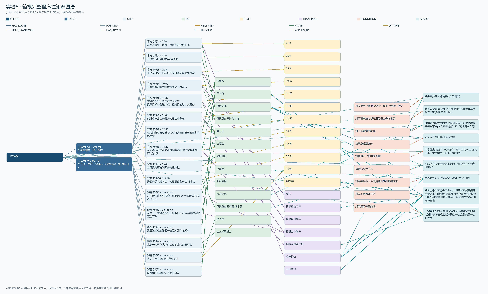

# 实验6：多源程序性知识融合与图谱可视化

负责人：FYH接管。路线抽取、实体对齐、原图谱构建和原12项测试来自YZH分支提交60a7dda；公共语料与实体来自DHT。本次继续已有实现，增加条件建议融合、验证、查询工具及完整展示，不把原成果记为从零重写。

## 输入、版本和融合

读取v1景区登记、DHT exp02-v1.1实体、YZH 4条30步路线和FYH 20条正式建议。schema_version=1.0、corpus_version=v1、graph_version=v2。图谱状态fused、missing_inputs=[]、advice_availability=available。v2增加了APPLIES_TO对TRANSPORT/TIME的支持；已有实体、路线和步骤节点ID保持不变，输入文件指纹保存在input_sha256。

状态route_stage/ entity_route_fused/ fused表示输入接入程度；advice_availability明确区分missing_upstream、available_empty、available，不能把“输入齐备”当成语义覆盖完整。

## Schema与语义

节点类型为SCENIC、ROUTE、STEP、POI、TIME、TRANSPORT、CONDITION、ADVICE。节点含node_id、node_type、name、scenic_id、source_refs、attributes。实体保留entity_id；路线、步骤、建议分别保留route_id、step_no、advice_id。来源文档ID可追溯标题、网址及采集时间，提取型内容保留原文证据。

| 关系 | 方向与含义 |
| --- | --- |
| HAS_ROUTE | 景区→来源明确的路线 |
| HAS_STEP | 路线→具体步骤 |
| NEXT_STEP | 同一路线前一步→后一步；不混合官方与游客链 |
| VISITS | 步骤→地点；交通目的地不自动意味着已经停留 |
| AT_TIME / USES_TRANSPORT | 步骤→原文时间/交通，提及必须落在步骤证据内 |
| HAS_ADVICE | 景区→建议 |
| TRIGGERS | 条件→建议 |
| APPLIES_TO | 建议→POI/TRANSPORT/TIME；只表示条件证据涉及的实体，不证明必访、许可或人群适用 |

实体按正式ID合并，过滤active:false，同名跨景区不合并。别名唯一匹配才对齐，歧义保留pending。相同地点跨路线共享实体，来源取并集，步骤和链独立。建议不同来源不互相覆盖，保留分类、历史属性和审校标记。不为凑数保留未关联实体，过滤清单写入JSON；同景区建议的来源矛盾不覆盖，分别留存条件和证据。

## 实际结果

151节点、205边。节点为POI 47、TIME 15、TRANSPORT 12、SCENIC 3、ROUTE 4、STEP 30、CONDITION 20、ADVICE 20。关系为HAS_ROUTE 4、HAS_STEP 30、NEXT_STEP 26、VISITS 30、AT_TIME 14、USES_TRANSPORT 14、HAS_ADVICE 20、TRIGGERS 20、APPLIES_TO 47。

相比原82节点/118边阶段图，新增条件建议及其涉及实体；路线仍4条30步，四条链分别10/6/12/2步，原30/30实体映射不变。优胜美地新增建议网络，但没有新增未实现的路线。



箱根展示69节点/103边，全部箱根节点均有位置、标签不截断。色彩区分8类节点和9类关系。HTML副本提供所有节点ID、边及来源检索，便于检查密集交叉关系；大图适合放大查看，报告截图可局部展示但应注明子图。

## 查询与质量验证

src/exp06_verify.py实际构建NetworkX MultiDiGraph，检查输入指纹、唯一ID、端点、同景区关系、实体活跃和类型、来源存在、证据位置、关系方向、孤立节点、建议完整覆盖与NEXT_STEP精确相邻链。src/graph_tools.py从真实图谱封装两个工具，查询不读取advice.json替代图谱；corpus仅用于来源元信息。查询示例及完整实际返回见exp06_quality.json：

1. 箱根全部路线：2条；上午筛选返回官方路线前4步，保持原序号。
2. 箱根family建议：1条官方儿童家庭建议，关联泡泡城堡、网之森林。
3. 蓝山weather建议：1条完整雨天活动回答块。
4. 箱根elderly建议：no_match；原文人群未标注不自动映射general。
5. 优胜美地路线：no_match；其crowding建议仍可查询，不能说整个景区没有数据。

图的3个弱连通分量分别对应3景区，景区隔离是预期结构。箱根实体中，箱根汤本和箱根空中缆车的入/出边总度数各为5，浪漫特快为4，反映入口与交通在路线和建议中的共同出现，不等于旅游价值或推荐强度。大涌谷有3条VISITS，来自官方不同活动和游客路线；不能去重成一次到访。典型游客有序路径为早云山→桃源台→芦之湖→金太郎展望台→姥子站→大涌谷，与官方钟点路线分别保存，可解释来源差异。

调用结果统一status/data/message。未知景区、参数非法、上游缺失返回error并给不同原因；输入已接入而未匹配为no_match。

## 真实失败与改进

接管时原构建器遇到非POI建议关联直接continue：S001_VIS_005“不想另外付费”涉及交通、20分钟和地点，旧策略会丢弃交通/时间关联；原yzh_figures布局也没有CONDITION/ADVICE，融合后会因未定位节点失败。本次通过全类型关联及完整布局解决，验证器要求每条建议的APPLIES_TO集合与输入完全一致，并有相关回归测试。这是从原代码与真实建议输入确认的工程边界，不把原阶段图称为已完成条件融合。

仍有局限：APPLIES_TO只表示相关，不区分条件中的原交通与建议中的替代交通；AT_TIME/USES_TRANSPORT采用证据包含规则，会漏掉标题外或跨句提及。图谱只覆盖选定路线，不提供距离、无障碍、实时开放或完整总时长。图的规模不是质量成绩；独立语义验收仍需组员完成。

## 复现

Python 3.12.6、NetworkX 3.4.2、Pillow 12.3.0。从根目录运行：

```powershell
py -3.12 src/exp03_routes.py
py -3.12 src/exp03_evaluate.py
py -3.12 src/exp06_graph.py --require-complete
py -3.12 src/exp06_verify.py
py -3.12 src/yzh_figures.py
py -3.12 -m unittest discover -s tests -v
```

yzh_figures保留YZH路线层级绘图，图谱部分转到exp06_visualize完整布局。交接见results/checks/exp06_handoff.md；历史YZH报告记录保留，接管说明优先描述本次v2状态。
