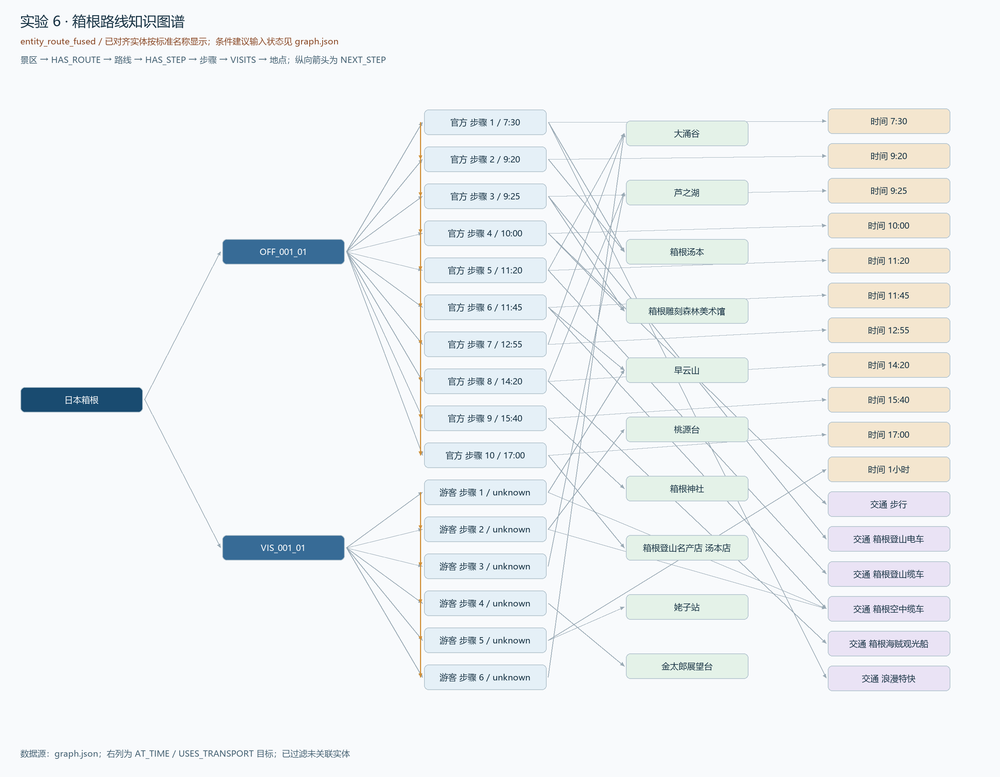

# 实验 6：多源程序性知识融合与图谱可视化

负责人：YZH。已接入 DHT 实验 2 的正式实体，完成路线、景点、交通、时间的真实融合、可视化与质量检查。条件建议等待 FYH 实验 5，当前不宣称已完成建议融合。合成测试不计为正式实验数据。

## 1. 输入与版本

正式运行读取景区登记、routes.json 和 DHT 的 entities.json（resource_version=exp02-v1），版本为 schema_version=1.0、corpus_version=v1、graph_version=v1。状态 route_stage 表示没有实体，entity_route_fused 表示已有实体但建议未到，fused 表示实体与建议均到位。当前状态为 entity_route_fused，missing_inputs 仅包含 advice.json；状态字段不替代质量验收。

当前路线来自箱根、蓝山的 4 篇文本；实体目录来自 DHT 的全 18 篇语料，关联实体保留其全部提及来源。官网和游客的来源差异持续保留。知识是各篇文本中的历史行程描述，不宣称其中价格、开放状态或交通状况是当前事实。

## 2. Schema 与融合规则

| 节点类型 | 含义和来源 |
| --- | --- |
| SCENIC | 景区登记表中的景区；只为实际有路线或建议的景区建节点 |
| ROUTE | 一条来源明确的路线，保存 route_id、text_type 和 scope_note |
| STEP | 路线内的具体步骤，保存 step_no、时间段、活动和原文证据 |
| POI | 景点或路线地点；未对齐时 entity_id=null、alignment_status=pending |
| TRANSPORT / TIME | 由实体目录导入的交通、时间实体，不凭空生成 |
| CONDITION / ADVICE | 条件与建议；只来自正式 advice.json |

| 关系 | 方向与建立条件 |
| --- | --- |
| HAS_ROUTE | 景区 → 路线 |
| HAS_STEP | 路线 → 步骤 |
| NEXT_STEP | 同一路线前一步 → 后一步，绝不把不同路线顺序混成单条链 |
| VISITS | 步骤 → 地点；交通步骤的地点可能是目的地，不能视为已经停留 |
| AT_TIME / USES_TRANSPORT | 步骤 → 时间/交通实体；要求实体提及完全落在该步的证据区间内 |
| HAS_ADVICE | 景区 → 建议 |
| TRIGGERS | 条件 → 建议 |
| APPLIES_TO | 建议 → 已确认的景点实体 |

实体目录节点使用 N_ENTITY_实体ID，过滤 active:false；未对齐地点使用景区和字面名称的确定性摘要 ID，不跨景区合并。目录正式名/别名唯一匹配才对齐，多义别名不自动合并。实体、路线、建议和边 ID 重复、引用无效、跨景区实体关联、步骤不连续等报错。相同地点在多条路线出现时合并地点节点并合并来源列表，各来源步骤和先后关系独立保留。重复活动不简单删除。未与本次路线或建议发生关联的目录实体不纳入输出图，过滤清单保存在 graph.json，避免用无关节点增加图谱规模。

节点及边保存 source_refs；步骤和提取型边还保存 attributes.evidence。未对齐节点在正式实体到位后可能替换为实体节点，因此正式接入时应按 entity_id/route_id 查询并重新生成，不把阶段性地点节点 ID 当作稳定的外部接口。

## 3. 正式结果与可视化

当前 graph.json 共 83 节点、119 边：2 景区、4 路线、30 步骤、24 地点、14 时间、9 交通；边为 HAS_ROUTE 4、HAS_STEP 30、NEXT_STEP 26、VISITS 30、AT_TIME 14、USES_TRANSPORT 15。30 步中 28 步对齐标准实体，2 步待确认。另导出 graph_nodes.csv、graph_edges.csv，列表和属性以 JSON 字符串存于 CSV 单元格。条件建议尚无正式输入。

图由实际 JSON 生成，展示箱根两条路线的全部步骤、关联地点及时间和交通实体；色彩及右列标签区分节点类型，橙色纵向箭头表示 NEXT_STEP。这是已融合实体的路线子图，尚未包含条件建议。

箱根的“大涌谷”被官方两步、游客一步访问，是两条路线的共享地点；官网包括“前往”与“游览”两个活动，保留这一差别。典型路径为游客“早云山 → 桃源台 → 芦之湖 → 金太郎展望台 → 姥子缆车站 → 大涌谷”。依据 DHT 的正式别名，早云山/早云山站和箱根汤本/箱根汤本站现已指向相同实体节点，保留目录对站区粒度的 note。

## 4. 质量与查询验证

src/exp06_verify.py 将正式 JSON 读为 NetworkX MultiDiGraph，检查节点唯一、来源文档存在、证据区间准确、边端点有效，以及每条路线的步骤链连通、无环且顺序一致。当前四条链分别为 10/6/12/2 步，NEXT_STEP 为 9/5/11/1。检查结果与实际图谱查询保存 results/checks/exp06_quality.json，包括：

1. 从 N_SCENIC_S001 沿 HAS_ROUTE 得到 2 条路线。
2. 从官方路线沿 HAS_STEP 取步骤、按 step_no 排序、沿 VISITS 取地点，得到 10 步。
3. 查询名称“大涌谷”的入向 VISITS，得到 3 个具体步骤。
4. 条件建议返回空结果，同时标记 missing_upstream，明确与“已接入但无匹配”不同。

12 项合成接口测试覆盖全类型融合、缺失输入、重复路线、不连续步骤、建议无效引用、跨景区引用、歧义别名、否定/纯眺望过滤和短推荐句保留。合成数据只在 tests/test_yzh.py 的内存中构造，未写入 data/outputs。这些测试证明代码分支能运行，不能替代真实数据抽查，也不能证明尚未交付的建议质量。

## 5. 局限与后续验收

真实失败案例：前版“早云山/早云山站”未合并，导致地点节点分裂；接入 DHT 确认的别名后已指向 S001_POI_009。中英文复合名称只有在两个组成部分各自唯一匹配相同 DHT 实体 ID 时才可对齐；据此已解决 Blackheath、Scenic World、Jenolan Caves 的三个复合名称。仍有姥子缆车站、温特沃斯瀑布野餐区 2 个名称待 DHT 确认，具体证据见 exp06_alignment.json；不删除“野餐区”等后缀后强行映射。

交通、时间关系采用证据区间包含规则，可能遗漏跨句指代或标题外描述。建议只在关联实体 ID 已确认时连接，不靠字符串猜测；这提高可核查性，也可能降低关系覆盖率。后续应抽样检查这些漏连，并与更宽的上下文窗口作对照。

核心验收使用 --require-entities，要求正式实体到位并运行图谱质量检查；已通过。任务书把条件建议作为可选融入内容，当前可提交核心实验成果；按组内约定，FYH 的 advice.json 到位后仍需补做建议融合，届时使用 --require-complete 并更新图表和查询。接收成员独立复核尚待完成。复现流程见 reports/YZH_运行与验收.md。
